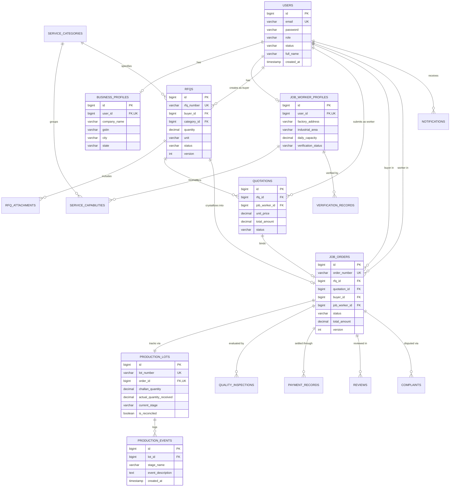

# Entity-Relationship (ER) Diagram — TexSetu

## 1. Complete Physical Schema Diagram

The physical database schema contains 17 tables normalized to Third Normal Form (3NF), maintaining strict referential integrity through foreign key cascades and constraints.

---

## 2. Integrity and Referential Guarantees

1. **Lot Passport Uniqueness**: Each confirmed `JOB_ORDER` possesses exactly one `PRODUCTION_LOT` record (`order_id` carries a `UNIQUE` constraint).
2. **Immutable Audit Trailing**: `PRODUCTION_EVENTS` records can only be inserted; application services expose no update or delete endpoints for milestone history.
3. **Atomic Quote Acceptance**: The foreign key `JOB_ORDERS.quotation_id` guarantees that every work order points to the explicitly selected quotation.
