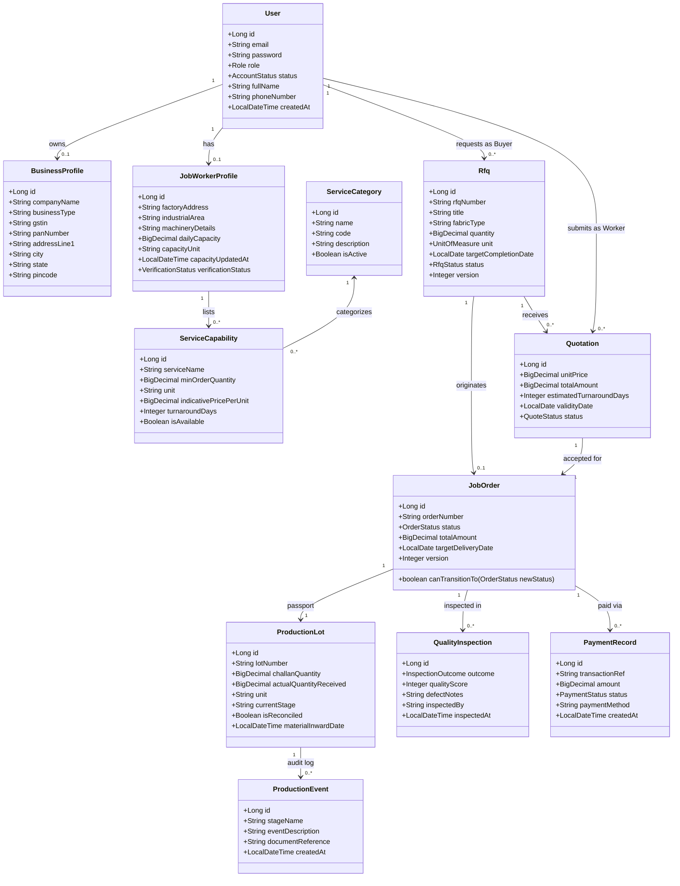

# UML Class Diagram & Domain Model — TexSetu

## 1. Domain Object Model Overview

TexSetu follows Domain-Driven Design (DDD) principles where entities encapsulate identity, invariants, and lifecycle transitions.



---

## 2. Enumerated State Models

### 2.1 OrderStatus State Machine Invariants
The `JobOrder` entity implements deterministic lifecycle guarding:
```java
public boolean canTransitionTo(OrderStatus next) {
    return switch (this.status) {
        case PLACED -> next == OrderStatus.MATERIAL_INWARDED || next == OrderStatus.CANCELLED;
        case MATERIAL_INWARDED -> next == OrderStatus.PROCESSING || next == OrderStatus.CANCELLED;
        case PROCESSING -> next == OrderStatus.INSPECTION || next == OrderStatus.DISPUTED;
        case INSPECTION -> next == OrderStatus.COMPLETED || next == OrderStatus.PROCESSING || next == OrderStatus.DISPUTED;
        case COMPLETED, CANCELLED -> false;
        case DISPUTED -> next == OrderStatus.PROCESSING || next == OrderStatus.COMPLETED || next == OrderStatus.CANCELLED;
    };
}
```

### 2.2 Core Enumerations
- **Role**: `BUYER`, `JOB_WORKER`, `ADMIN`
- **AccountStatus**: `PENDING`, `VERIFIED`, `REJECTED`, `SUSPENDED`
- **RfqStatus**: `DRAFT`, `OPEN`, `QUOTED`, `CLOSED`, `CANCELLED`
- **QuoteStatus**: `SUBMITTED`, `ACCEPTED`, `REJECTED`, `EXPIRED`
- **InspectionOutcome**: `ACCEPTED`, `REWORK_REQUIRED`, `REJECTED`
- **PaymentStatus**: `PENDING_ESCROW`, `HELD_IN_ESCROW`, `RELEASED_TO_WORKER`, `REFUNDED_TO_BUYER`
